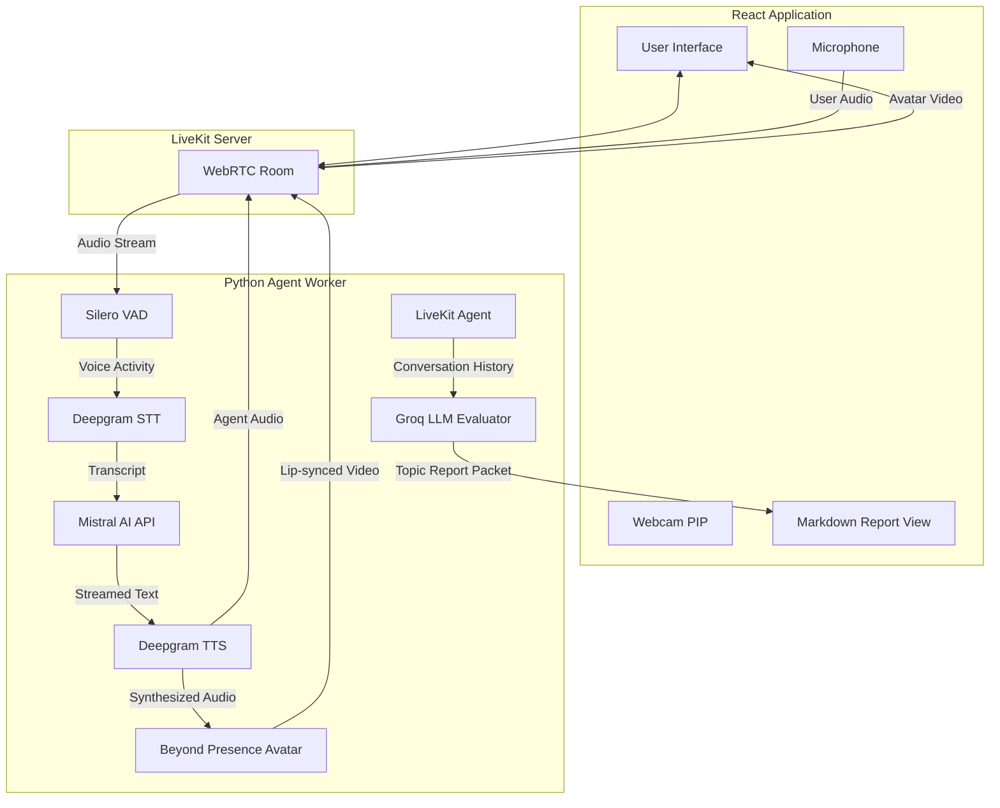
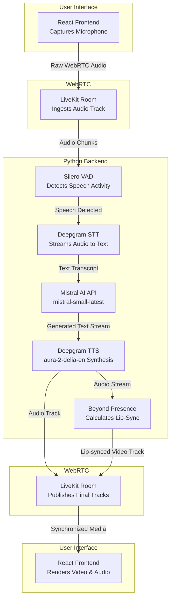

# TalkFlow AI: Adaptive Knowledge & Communication Evaluator


TalkFlow AI is a real-time, voice-first AI application designed to evaluate a user's technical knowledge and communication skills. More than just a standard interviewer, it acts as a comprehensive assessor utilizing an AI Avatar to create a natural, immersive conversational experience. 

The system adapts to the user's answers in real-time—increasing difficulty after strong answers and guiding the user through weak answers—to accurately measure their depth of understanding, clarity of speech, and confidence.

---

## 🚀 Features

- **Ultra-Low Latency Voice Chat**: Fully streaming audio pipeline from speech-to-text to LLM inference to text-to-speech.
- **Dual-LLM Engine Architecture**: Uses **Mistral AI** (`mistral-small-latest`) for real-time natural conversation and **Groq** (`openai/gpt-oss-120b`) for thorough, high-speed report evaluation.
- **Adaptive Questioning**: The AI evaluates answers on the fly and dynamically adjusts the interview difficulty.
- **Immersive AI Avatar with Audio Fallback**: A real-time video avatar that lip-syncs to the AI's generated voice, equipped with automatic fallback to pure audio mode if avatar limits are reached.
- **Domain-Tailored Evaluation**: Automatically generates a detailed Markdown report scoring Technical Knowledge, Communication, and Confidence customized specifically to the user's chosen interview topic.
- **Stateless Architecture**: Operates entirely in memory with a strict 10-minute session limit to ensure security and scalability.

---

## 🎯 Current Evaluation Topics

The system allows candidates to select specific domain topics for evaluation, including:

1. **Artificial Intelligence**: LLMs, AI ethics, agent autonomy, and model deployment.
2. **Trading & Finance**: Market trends, algorithmic trading execution, and portfolio risk management.
3. **Computer Science**: System design, distributed architecture, caching, and frontend optimization.
4. **General Communication**: Clarity of thought, structured speaking (Pyramid Principle), and conflict resolution.

---

## 🏗️ System Architecture

The application is split into a **React (Vite) Frontend** and a **Python Backend**, communicating entirely via LiveKit WebRTC.



### Simplified Linear Pipeline



---

## 🎙️ How the Audio & Conversation Pipeline Works

1. **Voice Activity Detection (VAD)**: The user's audio is streamed to the backend via WebRTC. **Silero VAD** monitors the stream to detect when the user starts and stops speaking.
2. **Speech-to-Text (STT)**: Once speech is detected, the audio is routed to **Deepgram STT**, which transcribes the audio into text in real-time.
3. **Conversational LLM**: The transcript is fed into **Mistral AI** (`mistral-small-latest`), which evaluates the response and asks a focused follow-up question.
4. **Text-to-Speech (TTS)**: As Mistral streams text response back, it is fed into **Deepgram TTS** (`aura-2-delia-en`).
5. **Playback**: The synthesized audio is streamed back through LiveKit directly to the user.

---

## 👤 Avatar & Fallback Handling

1. **Initialization**: An `AvatarSession` is spawned alongside the voice agent.
2. **Audio & Lip Sync**: The avatar intercepts Deepgram TTS audio and generates real-time video synchronized to the speech.
3. **Graceful Fallback**: If Beyond Presence API quota is reached or unavailable, the backend seamlessly falls back to audio-only voice agent mode, ensuring uninterrupted interview sessions.

---

## 📊 Evaluation & Report Generation

When the session completes:
1. The backend extracts the conversation transcript from `agent_session.history.messages()`.
2. It passes both the **Interview Topic** and **Transcript** into a domain-tailored Evaluation Prompt.
3. **Groq** (`openai/gpt-oss-120b`) generates a structured Markdown report scoring:
   - **Technical / Domain Understanding** (tailored specifically to the chosen topic)
   - **Communication Skills**
   - **Confidence**
   - **Strong & Weak Concepts**
   - **Actionable Learning Recommendations**
4. The report is published over LiveKit's Data Channel and rendered cleanly in the React frontend.

---

## 🛠️ Tech Stack

- **Frontend**: React, Vite, LiveKit Components React (`@livekit/components-react`)
- **Backend**: Python, `asyncio`, LiveKit Agents (`livekit-agents`)
- **WebRTC Transport**: LiveKit
- **Speech-to-Text**: Deepgram
- **Text-to-Speech**: Deepgram Aura (`aura-2-delia-en`)
- **Conversational LLM**: Mistral AI (`mistral-small-latest`)
- **Evaluator LLM**: Groq (`openai/gpt-oss-120b`)
- **Avatar Provider**: Beyond Presence (`livekit-plugins-bey`)

---

## ⚙️ Setup & Installation

1. **Install Python Dependencies:**
   ```cmd
   python -m venv .venv
   .venv\Scripts\activate
   pip install livekit-agents livekit-plugins-deepgram livekit-plugins-elevenlabs livekit-plugins-bey livekit-plugins-silero livekit-plugins-groq livekit-plugins-openai python-dotenv
   ```

2. **Install Frontend Dependencies:**
   ```cmd
   cd frontend
   npm install
   ```

3. **Configure Environment Variables:**
   Create a `.env` file in the root directory:
   ```env
   LIVEKIT_URL=wss://your-livekit-domain.livekit.cloud
   LIVEKIT_API_KEY=your_livekit_key
   LIVEKIT_API_SECRET=your_livekit_secret
   DEEPGRAM_API_KEY=your_deepgram_key
   MISTRAL_API_KEY=your_mistral_key
   GROQ_API_KEY=your_groq_key
   BEY_API_KEY=your_bey_avatar_key
   ```

4. **Run the Application:**
   ```cmd
   start.bat
   ```
