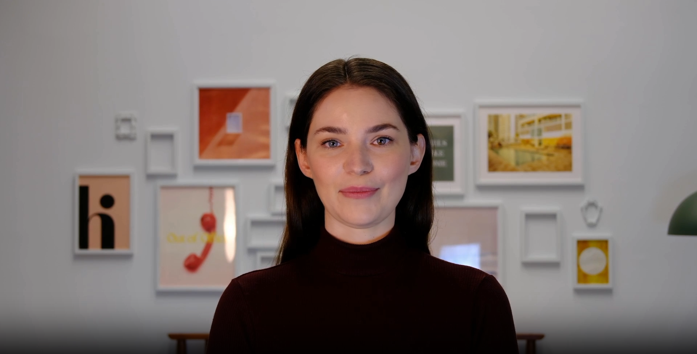
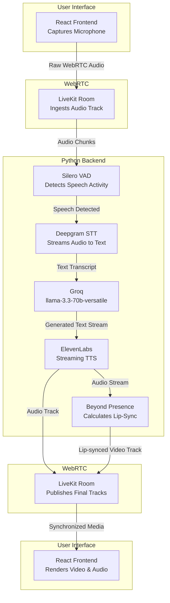

# TalkFlow AI: Adaptive Knowledge & Communication Evaluator



TalkFlow AI is a real-time, voice-first AI application designed to evaluate a user's technical knowledge and communication skills. More than just a standard interviewer, it acts as a comprehensive assessor utilizing an AI Avatar to create a natural, immersive conversational experience. 

The system adapts to the user's answers in real-time—increasing difficulty after strong answers and guiding the user through weak answers—to accurately measure their depth of understanding, clarity of speech, and confidence.

---

## 🚀 Features

- **Ultra-Low Latency Voice Chat**: Fully streaming audio pipeline from speech-to-text to LLM inference to text-to-speech.
- **Groq-powered LLMs**: `llama-3.3-70b-versatile` for the real-time conversation and `openai/gpt-oss-120b` for the final report.
- **Live status & transcript**: The UI shows whether the interviewer is Listening, Thinking or Speaking, a live transcript, and the remaining time.
- **Measured communication metrics**: Speaking pace (wpm), filler words and long pauses are measured from the audio pipeline and fed into the report.
- **Adaptive Questioning**: The AI evaluates answers on the fly and dynamically adjusts the interview difficulty.
- **Immersive AI Avatar with Audio Fallback**: A real-time video avatar that lip-syncs to the AI's generated voice, equipped with automatic fallback to pure audio mode if avatar limits are reached.
- **Domain-Tailored Evaluation**: Automatically generates a detailed Markdown report scoring Technical Knowledge, Communication, and Confidence customized specifically to the user's chosen interview topic.
- **Stateless Architecture**: Operates entirely in memory with a strict 10-minute session limit to ensure security and scalability.

---

## 🎯 Current Evaluation Topics

Candidates pick a domain and a topic (edit `DOMAINS` in `frontend/src/App.tsx` to change them):

1. **Technical**: Artificial Intelligence, LLMs, Transformers, Prompt Engineering, DSA, Operating Systems, DBMS, Computer Networks, OOP, System Design.
2. **Trading**: Liquidity, Support and Resistance, Market Structure, Price Action, Candlestick Patterns, Risk Management, Supply and Demand, Order Blocks, BOS, CHOCH.

---

## 🏗️ System Architecture

The application is split into a **React (Vite) Frontend** and a **Python Backend**, communicating entirely via LiveKit WebRTC.


### Simplified Linear Pipeline



---

## 🎙️ How the Audio & Conversation Pipeline Works

1. **Voice Activity Detection (VAD)**: The user's audio is streamed to the backend via WebRTC. **Silero VAD** monitors the stream to detect when the user starts and stops speaking.
2. **Speech-to-Text (STT)**: Once speech is detected, the audio is routed to **Deepgram STT**, which transcribes the audio into text in real-time.
3. **Conversational LLM**: The transcript is fed into **Groq** (`llama-3.3-70b-versatile`), which evaluates the response and asks a focused follow-up question.
4. **Text-to-Speech (TTS)**: The streamed reply is synthesized by **ElevenLabs** (falls back to Deepgram Aura when `ELEVENLABS_API_KEY` is not set).
5. **Playback**: The synthesized audio is streamed back through LiveKit directly to the user.

---

## 👤 Avatar & Fallback Handling

1. **Initialization**: An `AvatarSession` is spawned alongside the voice agent.
2. **Audio & Lip Sync**: The avatar intercepts the TTS audio and generates real-time video synchronized to the speech.
3. **Graceful Fallback**: If Beyond Presence API quota is reached or unavailable, the backend seamlessly falls back to audio-only voice agent mode, ensuring uninterrupted interview sessions.

---

## 📊 Evaluation & Report Generation

When the session completes:
1. The backend extracts the conversation transcript from `agent_session.history.messages()`.
2. It passes the **Interview Topic**, **Transcript** and **measured speaking metrics** into a domain-tailored Evaluation Prompt.
3. **Groq** (`openai/gpt-oss-120b`) generates a structured Markdown report scoring:
   - **Technical / Domain Understanding** (tailored specifically to the chosen topic)
   - **Communication Skills**
   - **Confidence**
   - **Strong & Weak Concepts**
   - **Actionable Learning Recommendations**
4. The report is published over LiveKit's Data Channel and rendered cleanly in the React frontend.

---

## 🛠️ Tech Stack

- **Frontend**: React, Vite, LiveKit Components React (`@livekit/components-react`)
- **Backend**: Python, `asyncio`, LiveKit Agents (`livekit-agents`)
- **WebRTC Transport**: LiveKit
- **Speech-to-Text**: Deepgram
- **Text-to-Speech**: ElevenLabs (Deepgram Aura fallback)
- **Conversational LLM**: Groq (`llama-3.3-70b-versatile`)
- **Evaluator LLM**: Groq (`openai/gpt-oss-120b`)
- **Avatar Provider**: Beyond Presence (`livekit-plugins-bey`)

---

## ⚙️ Setup & Installation

1. **Install Python dependencies** (Python 3.10+):
   ```bash
   python -m venv .venv
   source .venv/bin/activate          # Windows: .venv\Scripts\activate
   pip install -r requirements.txt
   ```

2. **Install frontend dependencies:**
   ```bash
   cd frontend && npm install
   ```

3. **Configure environment variables** in a `.env` file in the project root:
   ```env
   LIVEKIT_URL=wss://your-livekit-domain.livekit.cloud
   LIVEKIT_API_KEY=your_livekit_key
   LIVEKIT_API_SECRET=your_livekit_secret
   DEEPGRAM_API_KEY=your_deepgram_key
   GROQ_API_KEY=your_groq_key
   ELEVENLABS_API_KEY=your_elevenlabs_key   # optional, falls back to Deepgram TTS
   BEY_API_KEY=your_bey_avatar_key          # optional, falls back to audio-only
   ```

4. **Run** (token server on :8880, agent worker, frontend on :5173):
   ```bash
   ./start.sh        # macOS / Linux
   start.bat         # Windows
   ```

## 📁 Project Structure

```text
app/
  main.py          LiveKit agent: pipeline, avatar, 10-minute timer, report delivery
  session.py       In-memory session state and speaking metrics (run `python -m app.session` to self-test)
  evaluator.py     Transcript extraction and Groq report generation
  prompts.py       Interviewer and evaluation prompts
  token_server.py  Local LiveKit token endpoint for the frontend
frontend/          React + Vite + LiveKit Components UI (api/token.py is the Vercel token endpoint)
```
