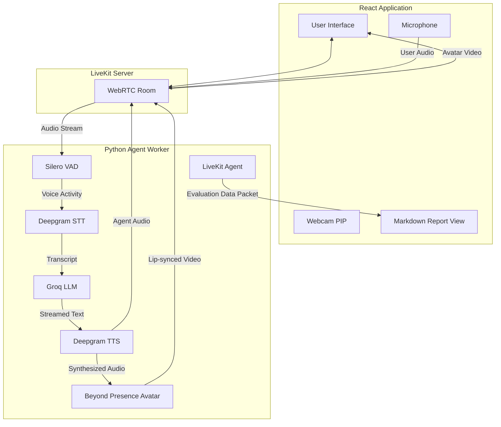
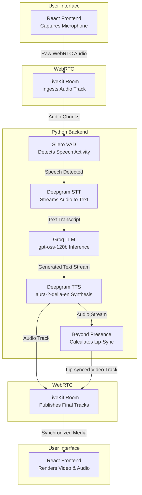
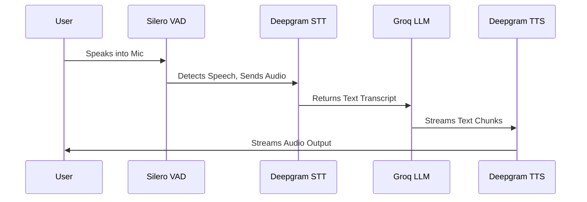
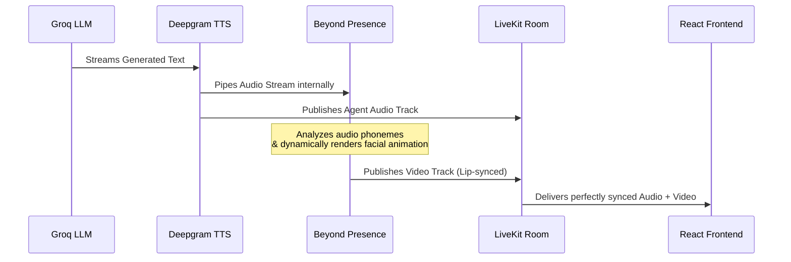

# TalkFlow AI: Adaptive Knowledge & Communication Evaluator


TalkFlow AI is a real-time, voice-first AI application designed to evaluate a user's technical knowledge and communication skills. More than just a standard interviewer, it acts as a comprehensive assessor utilizing an AI Avatar to create a natural, immersive conversational experience. 

The system adapts to the user's answers in real-time—increasing difficulty after strong answers and guiding the user through weak answers—to accurately measure their depth of understanding, clarity of speech, and confidence.

---

## 🚀 Features

- **Ultra-Low Latency Voice Chat**: Fully streaming audio pipeline from speech-to-text to LLM inference to text-to-speech.
- **Adaptive Questioning**: The AI evaluates answers on the fly and dynamically adjusts the interview difficulty.
- **Immersive AI Avatar**: A real-time video avatar that lip-syncs to the AI's generated voice.
- **Comprehensive Evaluation**: Automatically generates a detailed Markdown report scoring Technical Knowledge, Communication, and Confidence without relying on persistent databases.
- **Stateless Architecture**: Operates entirely in memory with a strict 10-minute session limit to ensure security and scalability.

---

## 🎯 Current Evaluation Topics

For this MVP phase, the system is pre-configured to evaluate candidates across exactly **4 specific domains**:

1. **Artificial Intelligence**: LLMs, AI ethics, agent autonomy, and model deployment.
2. **Trading & Finance**: Market trends, algorithmic trading execution, and portfolio risk management.
3. **Computer Science**: System design, distributed architecture, caching, and frontend optimization.
4. **General Communication**: Clarity of thought, structured speaking (Pyramid Principle), and conflict resolution.

---

## 🏗️ System Architecture

The application is split into a **React (Vite) Frontend** and a **Python Backend**, communicating entirely via LiveKit WebRTC.



### Simplified Linear Pipeline

If you prefer a straight-line view of how data travels through the system during a conversation:



---

## 🎙️ How the Audio Pipeline Works

The core of the application relies on a **streaming pipeline** to ensure conversational latency remains as low as possible. 

1. **Voice Activity Detection (VAD)**: The user's audio is streamed to the backend via WebRTC. **Silero VAD** monitors the stream to detect when the user starts and stops speaking.
2. **Speech-to-Text (STT)**: Once speech is detected, the audio is routed to **Deepgram STT**, which transcribes the audio into text in real-time.
3. **Large Language Model (LLM)**: The transcript is added to the interview context and streamed to **Groq** (using `openai/gpt-oss-120b`). The LLM is instructed by a strict System Prompt to evaluate the response and ask exactly *one* follow-up question.
4. **Text-to-Speech (TTS)**: As the LLM streams its text response back, it is immediately fed into **Deepgram TTS** (using the `aura-2-delia-en` voice model).
5. **Playback**: The synthesized audio is streamed back through the LiveKit room directly to the user's headset.



---

## 👤 How the Avatar Works

To make the interview feel human, the system uses **Beyond Presence** via the `livekit-plugins-bey` package.

1. **Initialization**: When the backend agent starts, an `AvatarSession` is spawned alongside the main AI agent.
2. **Audio Sync**: The avatar intercepts the synthesized audio stream coming from Deepgram TTS.
3. **Video Generation**: Beyond Presence processes the audio and generates a high-quality, real-time video stream where the avatar's lips perfectly synchronize with the spoken words.
4. **Rendering**: This video stream is published to the LiveKit room as a standard camera track. The React frontend hooks into this track using `<VideoTrack />` and renders the AI Coach on the screen.



---

## 📊 Evaluation & Report Generation

Because the application is stateless (no database), all conversation history is stored in RAM during the active session. 

When the strict 10-minute timer expires (or the user clicks "Stop Session"), the following happens:
1. The backend aggregates the entire conversation into a single transcript string.
2. The agent pauses its conversational persona and creates a **fresh, isolated Chat Context**.
3. It injects a highly detailed **Evaluation Prompt** outlining the scoring rubrics for Technical Knowledge, Communication, and Confidence.
4. The LLM generates a formatted Markdown report.
5. The backend encodes this report as a JSON payload and publishes it as a data packet over the LiveKit Data Channel.
6. The frontend listens for the `data_received` event, catches the `report` payload, and renders it beautifully using `ReactMarkdown`.

---

## 🛠️ Tech Stack

- **Frontend**: React, Vite, LiveKit Components React (`@livekit/components-react`)
- **Backend**: Python, `asyncio`, LiveKit Agents (`livekit-agents`)
- **WebRTC Transport**: LiveKit
- **Speech-to-Text**: Deepgram
- **Text-to-Speech**: Deepgram Aura Text-to-Speech (using the `aura-2-delia-en` voice model)
- **Language Model**: Groq (`gpt-oss-120b`)
- **Avatar Provider**: Beyond Presence

---

## ⚙️ Setup & Installation

1. **Install Python Dependencies:**
   ```bash
   python -m venv .venv
   .venv\Scripts\activate
   pip install livekit-agents livekit-plugins-deepgram livekit-plugins-elevenlabs livekit-plugins-bey livekit-plugins-silero livekit-plugins-groq python-dotenv
   ```

2. **Install Frontend Dependencies:**
   ```bash
   cd frontend
   npm install
   ```

3. **Configure Environment Variables:**
   Ensure you have a `.env` file in the root directory with the following keys:
   ```env
   LIVEKIT_URL=...
   LIVEKIT_API_KEY=...
   LIVEKIT_API_SECRET=...
   DEEPGRAM_API_KEY=...
   GROQ_API_KEY=...
   BEY_API_KEY=...
   ```

4. **Run the Application:**
   Execute the included launch script to start all services simultaneously:
   ```cmd
   start.bat
   ```
